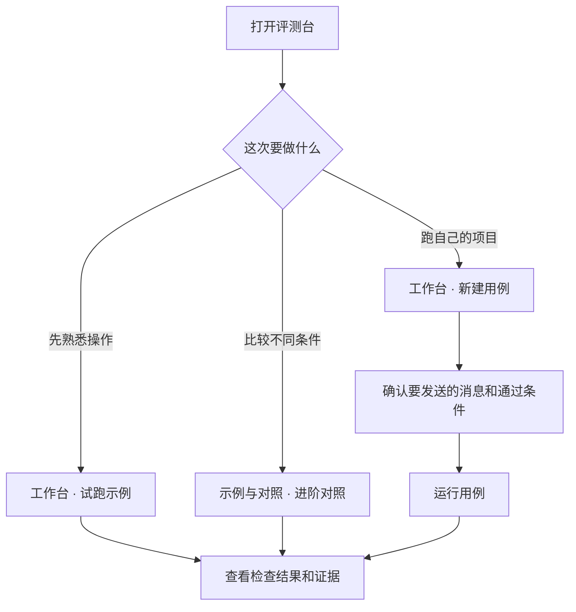
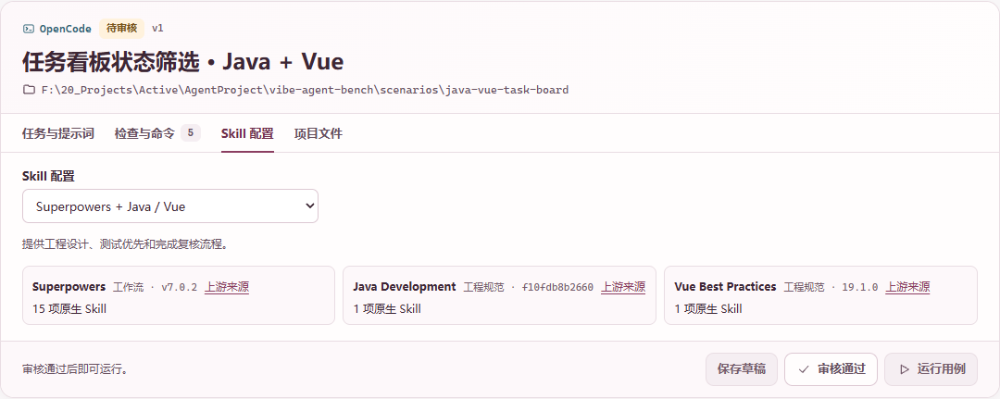
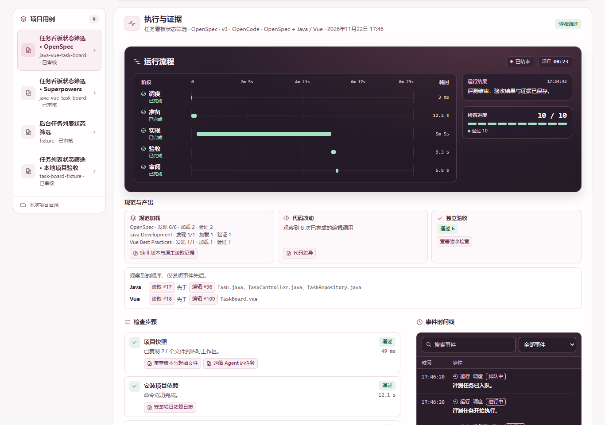

# Vibe Agent Bench 手把手使用教程

先用内置演示走一遍，再创建自己的评测用例。一次评测的结果是一份报告，里面有 Agent 做了什么、平台独立验证了什么，以及支撑每项结果的日志、差异或截图。已有报告可以随时打开回看。

已有平台服务时可以直接打开工作台。 [评测台](http://127.0.0.1:4317/) · [示例与对照](http://127.0.0.1:4317/?view=benchmark)

## 1. 认清工作区入口

| 你想做什么 | 打开哪里 | 找哪个按钮 |
| --- | --- | --- |
| 第一次熟悉整个过程 | 「工作台」 | **试跑示例（无需密钥）** |
| 用同一示例单测 Codex、OpenCode 或 DSH | 「示例与对照 → 进阶对照」 | 选 Agent 和 Skill，点 **开始评测** |
| 比较 Codex、OpenCode 各有、无 Skill 的表现 | 「示例与对照 → 进阶对照」 | **运行四组对照** |
| 评测 Java + Vue 场景或自己的项目 | 「工作台」 | **新建用例**，确认后运行 |
| 看以前的结果 | 「运行记录」 | 按类型筛选，点对应条目 |

「工作台」用于创建和确认本机项目的用例。「示例与对照」提供固定示例和对照设置。「运行记录」能重新打开历次结果。顶部的「模型配置」在需要让 Agent 真正执行时使用。

地址里的 `run` 参数定位单次运行，`experiment` 参数定位四组对照批次。可以复制整条地址，下次在同一台机器上回看。旧的 `/benchmark` 报告地址也能打开同一工作区。



## 2. 第一次操作用「试跑示例」

演示使用随仓库提供的参考实现，运行真实的本地检查，模型调用次数为零。服务在线时，这一步可以直接开始。 [直达演示入口](http://127.0.0.1:4317/?view=benchmark#run-demo)

1. 在「工作台」点 **试跑示例（无需密钥）**，等「运行结果」更新。
2. 先看报告顶部的结论。点「看检查依据」，可直接展开对应检查。
3. 想了解过程时，展开「查看运行详情」，再看「运行流程」。参考实现的示例主要看**检查**阶段。
4. 在「检查步骤」里，看代码规范、后端启动、前端启动、API 行为、页面联调、测试辨别力这六项。演示用参考实现跑这六项验收。Agent 实现、Skill 验证和模型审阅显示为跳过。
5. 先找「页面联调」，点 **状态筛选截图**，看页面有没有切换到选定状态。再点 **空结果截图**，看无匹配项时的反馈。点击「关闭」回报告。
6. 在「API 行为」里点 **API 请求与断言**。顺着实际请求、状态码和断言看平台验收了哪些条件。
7. 在「测试辨别力」里点 **缺陷复现与测试日志**。平台会对健康版、故意引入缺陷的副本和恢复版执行测试。健康版与恢复版通过、缺陷副本触发相应断言失败，这项检查才算通过。
8. 打开「运行记录」，可筛选内置评测，点击刚完成的条目即可回到这份报告。

## 3. 从你眼前的报告开始读

先看「运行结果」给出的结论和原因。想追查时点「看检查依据」或展开「查看运行详情」。下面这些是根据问题选看的内容。

| 去哪里 | 点什么 | 你能确认什么 |
| --- | --- | --- |
| 「运行流程」 | 查看阶段状态和耗时 | Agent 用了多久，验收与审阅是否已经结束 |
| 「Agent 产出」 | **代码差异** | 改了哪些文件、增加或删除了哪些代码 |
| 「Skill 证据」 | **Skill 观察证据** | 是否记录到选用和实际读取 Skill 正文，以及文件完整性 |
| 「页面联调」「测试辨别力」 | **状态筛选截图**、**缺陷复现与测试日志** | 页面实际表现，以及测试能否发现对应的已知缺陷 |

「已结束」是运行状态。要判断这一轮做得怎么样，再看每个检查标注的「通过」「失败」或「阻塞」。如果某个历史阶段显示「未记录」，表示该旧记录缺少足够的时间事件。该轮的检查结果和已保存证据仍可查看。

看完内置评测报告再点「发起复测」。这个按钮会按照当时的 Agent 和 Skill 条件，从初始样例新跑一轮，使用当前评测台配置。用它复测真实评测会触发 Agent 和审阅阶段。

## 4. 跑一轮真实的内置题目

### 第 1 步 确认要用哪个 Agent

- **OpenCode v1.19.6** 和 **DeepSeek Harness（DSH）** 共用顶部「模型配置」所显示的服务、模型和 API 密钥。只有 DeepSeek 或内网模型时，直接选这两个 Agent。配置方法见第 10 节。
- **Codex** 使用本机 Codex CLI 的 ChatGPT 登录。终端里运行 `codex login status` 可查看登录状态。配置了项目 API 密钥时，平台的独立审阅阶段使用该密钥。没有项目密钥时，审阅阶段尝试使用本机 Codex CLI 登录。

OpenAI 默认配置为 `gpt-6-luna`、`medium`。OpenCode、DSH 和审阅可通过第 10 节切换服务。历史报告保留了每轮启动配置。在「Agent 产出」中打开相应的启动配置证据，可以确认该轮模型是谁。

### 第 2 步 选择有无 Skill

1. 进入「示例与对照」，展开「进阶对照」，在 `Agent` 下拉框选择 **OpenCode**。
2. 在 `Skill` 下拉框选择 **有 Skill**。内置题目会把目标 `task-status-filter` Skill 放入该轮工作副本。
3. 点击 **开始评测**。页面会选中新运行。排队和执行期间同一服务一次接受一轮单次评测或一个对照批次。
4. 观察「运行流程」。实现进行时等 Agent 写代码。验收开始后看独立测试结果。审阅开始后等建议生成。OpenCode 实现阶段的执行上限为 10 分钟，依赖安装、验收和审阅分别计时。
5. 结束后对照第 3 节查看证据。再次选择 **无 Skill** 后点「开始评测」，就能在同一个内置题目里观察目标 Skill 缺席的条件。

两轮会生成不同的运行记录。对照时记录业务检查是否通过，再比较 Skill 激活和正文读取证据。两轮都通过也可以是有用结果，例如功能结果相同，但一轮能证明正文被读取。

### 同时比较两种 Agent

Codex 和 OpenCode 都准备好后，在「示例与对照 → 进阶对照」点击 **运行四组对照**。这会启动四次真实实现评测，两条 Agent 队列并行，各自按顺序执行两组。

| 队列 | 第 1 轮 | 第 2 轮 |
| --- | --- | --- |
| Codex | 有 Skill | 无 Skill |
| OpenCode | 无 Skill | 有 Skill |

在「四组对照」先看「执行进度」，点某个组名在当前视图打开它的「运行流程」。再向下看表格里的「激活证据」「读取证据」和六项业务检查。表格右侧有「查看报告」，屏幕窄时可以横向滑动。两种 Agent、四个条件的任务提示词相同，源项目从同一内置基线准备。每组各一次只反映这批运行的观察结果。

## 5. 从零创建 Java + Vue 的真实用例

这条路线练习的事和内置题目不同。你会先审查一个可修改的用例，再用 OpenCode 在 Java + Vue 运维任务看板上添加状态筛选。项目自带独立 API、浏览器、构建和代码规范检查。开始前需要本机安装 JDK 17 或更高版本。 [打开用例工作台](http://127.0.0.1:4317/)

### 第 1 步 生成草稿

1. 点顶部 **新建用例**。
2. 展开「可选设置」，点 **使用 Java + Vue 场景**。页面会填入项目目录、用例标题和需求。项目目录以 `scenarios\java-vue-task-board` 结尾。
3. 点 **生成审核草稿**。左侧「项目用例」出现新条目，详情显示「待确认」。

### 第 2 步 审核用例

先在摘要里核对输入、预期结果和通过条件。要改配置或查看细节时，再点「编辑用例」。

| 标签 | 按什么顺序看 | 怎么知道可以继续 |
| --- | --- | --- |
| **输入与预期** | 先选「执行 Agent」，再核对场景说明和实际发送给 Agent 的消息 | 消息清楚写明默认全部、三种状态、搜索交集、非法或重复参数 400、空结果提示及保护已有测试 |
| **检查与命令** | 看准备命令，再看验证命令 | 此场景预置 5 条命令。依赖安装属于准备，API、浏览器、构建、规范属于验证 |
| **Skill 配置** | 看选择的工作流、包和版本 | 首次可保留默认的「Superpowers + Java / Vue」，下面显示 Superpowers、Java Development、Vue Best Practices 的版本 |
| **项目文件** | 点开一份源码，再点开一份验收测试 | 代码预览正常，可确认项目确实是看板样例。按 `Esc` 或点关闭按钮返回 |



场景说明记录你希望验证什么，发给 Agent 的消息是运行时实际交给它的文字。在「编辑用例」里可分别修改。需要修改时可以先点「保存草稿」，准备好再审核。

### 第 3 步 审核并运行

1. 点击 **确认用例**，状态变为「已确认」，显示版本号，例如 `v2`。这一版锁定任务、命令和 Skill 版本。
2. 点击 **运行用例**，进入「执行与证据」。同一个已审核版本已有运行时，按钮会显示 **再次运行**。
3. 等待「准备」完成。第一次在工作副本中安装依赖需要访问 npm。依赖准备成功后，才会启动已选择的 Agent。
4. 「实现」进行中时可以刷新页面。页面会按运行 ID 重新连接到同一份事件记录。向上滚动能读早期日志，想回到新事件时点 **跳到最新**。
5. 看「运行结果」。可以在「运行记录」找到此次用例，更改已确认的配置后，确认新版本即可运行。

### 第 4 步 比较 OpenSpec 与 Superpowers

1. 再创建一个相同的 Java + Vue 场景用例，给标题加上 `OpenSpec` 方便辨认。保持项目源码、任务提示词和独立验收命令一致。
2. 在「Skill 配置」改选 **OpenSpec + Java / Vue**。审核通过并运行。这个场景的依赖准备会安装锁定的本地 OpenSpec CLI。
3. 两份报告都看「Skill 加载与读取」「代码差异」「Java 服务与 API 契约」「Vue 页面与真实浏览器联调」。OpenSpec 报告还会有 **OpenSpec 变更与校验**，可以打开提案、设计、增量规范、任务清单和严格校验日志。
4. 想单看 Java、Vue 规范效果，可以另设 **Java / Vue 规范**。想保留相同任务而省去这些包，可以另设 **无配置 Skill**。使用各自的运行 ID 回看。

## 6. 在「执行与证据」定位问题



用报告顶部的章节按钮定位证据、检查或时间线。回看内置报告时，点「发起评测」可展开配置。

点击证据后，弹窗默认打开「证据摘要」。Skill 读取、API 请求、页面联调和缺陷测试可以按结果、表格和截图查看。「原始内容」在同一弹窗展示原文；「打开原件」可以查看整份文件。

1. **看运行进度。** 「调度」对应入队和启动，「准备」对应复制项目和安装依赖，「实现」对应 Agent 工作，「验收」对应平台独立命令，「审阅」对应基于检查结果的建议。点击有记录的阶段，可用来缩小事件范围。
2. **看「关键证据」。** 「规范加载」列出本轮发现、加载和正文验证数，「代码改动」链接最终差异，「独立验收」定位检查结果。下方记录可定位到真实读取、编辑事件。出现「读取先于编辑」时，能确认的是时间顺序。
3. **看 Skill 的三个数字。** 「发现」表示原生清单列出了这个 Skill。「加载」表示观察到对应工具调用。「正文验证」表示平台在本轮返回里找到了核验正文的证据。发现多个 Skill 时，只会把实际加载和核验的项计入后两个数字。
4. **看真正改了什么。** 在「OpenCode 产出」点「代码差异」。绿色行是新增，红色行是删除。用「原始文件」打开完整差异。代码差异展示候选副本相对本轮起点的变化。
5. **看真正怎么验收。** Java + Vue 项目下，「HTTP 请求与断言」记录接口输入输出。「筛选页面截图」和「空结果截图」来自浏览器验证。「代码规范」与「生产构建」分别对应各自的命令日志。
6. **需要找一条事件时用搜索。** 在「搜索执行事件」输入 `openspec-apply-change`、`test:api`、`TaskBoard.vue`，或你看到的证据文件名。结果依据事件正文、详情和证据名匹配。下拉框可以切「全部事件」「Agent 工具」「Skill」「命令输出」或相应执行阶段。找不到时切回「全部事件」再试。
7. **看修复建议。** 找到第一个「失败」或「异常」的检查，先展开它的原始证据，再看审阅给出的修复和复测步骤。建议里引用的检查可跳回对应证据。下游出现「阻塞」时，从它提示的前置步骤开始找原因。

一次运行使用启动时复制的项目副本。审核版本固定的是评测配置，每次启动会按当时目录内容重新准备项目快照。所以改过源项目后再次运行时，报告可能使用不同的起点。可在「项目快照」的「审查版本与起始文件」查看本轮记录。

## 7. 用自己的项目和验收条件

### 先写成可以检查的需求

下面以「给工单列表添加优先级筛选」为例。你可以把这四句改成自己项目的需求。

- 工单列表目前按更新时间展示，支持关键词搜索。
- 增加全部、高、中、低四个选择，切换后请求对应接口。
- 优先级可与关键词组合，结果仍按原顺序展示，空结果有提示，非法参数按现有契约处理。
- 可修改对应页面、接口并新增回归测试。既有验收脚本与受保护配置须保留原样。

### 将需求和命令录到工作台

1. 找到项目根目录。通常里面有 `README.md`、`package.json`、`go.mod` 或相应的构建清单。在 PowerShell 进入项目后执行 `Get-Location`，复制显示的完整路径。
2. 打开「新建用例」，选择「自己写一条」，填入路径、标题、需求，点「生成审核草稿」。平台能识别部分常见项目命令，生成后请逐条核对。
3. 展开「编辑用例」，在「检查与命令」看每条的「执行阶段」「程序」「参数」「超时」。准备命令在 Agent 前执行，验证命令在实现完成后独立执行。命令从工作副本根目录运行。
4. 用「添加命令」补充项目自己的检查。例如要执行 `npm run test`，程序填 `npm`，参数第一行填 `run`、第二行填 `test`，阶段选「验证」，超时可先填 `120000` 毫秒。选一条你自己已经能在项目目录跑通的校验命令。
5. 审查「Agent 提示词」是否明确了边界。指定允许修改的源码范围，描述如何新增测试，并写出你会用来验收的行为。选择适合该项目的 Skill，审核通过后启动。
6. 验收通过后先读差异再决定是否合入原项目。评测报告与候选差异保存在本地 `runs/<运行 ID>/artifacts/`。按同样的工作副本方式也可以把候选版本启动起来手测。

在「想检查什么」里选你要测的行为。「只分析，保持文件原样」会检查零写入。「先给方案，确认后再改」可以核对提案阶段的写入边界。测代码规范时，可在编辑时加上必读规范或独立检查。发送的消息和通过条件都在确认页预览。

想一次测试多条时，在「新建用例」选择「按项目 Skill 生成多条」，填入项目目录，点「生成多条测试用例」。确认想跑的条目后，点「运行这条」或「运行待测的 N 条」。想重复跑已有记录的那一条，点「再跑一次」。缺测试条件的条目和补法可在清单下方展开。

想补一个现有清单没有的用例，点清单顶部的「补充测试场景」，说一句要测的行为，生成后再审核。发现某条暂时跑不了时，展开「怎么补」核对具体缺口，也可点该条的「AI 帮我补」。若 AI 准备了测试文件，在审核前可以展开预览。

想亲手操作候选页面，可按 Java + Vue 专项教程中「手动操作候选页面」的步骤，把 `candidate.diff` 用 `git apply --check` 核对，再应用到临时副本。两个终端分别运行 `npm run dev:api` 与 `npm run dev:web`，随后用真实页面做测试。默认页面端口是 `5180`，默认 Java API 端口是 `8180`，评测台在 `4317`。 [Java + Vue 人工复测教程](人工复测.md)

## 8. 常见卡点对照表

| 看到什么 | 先查哪里 | 接下来怎么做 |
| --- | --- | --- |
| 网页显示无法访问 | 服务终端和 `4317` | 按第 9 节启动，再打开页面。端口已有本项目监听时，打开现有地址即可 |
| 「运行用例」是灰色的 | 用例状态和底部提示 | 检查是否「待审核」、有未保存修改、版本需要重新审核、Skill 版本有变化或正在运行 |
| 提示已有评测正在执行 | 「运行记录」或「四组对照」 | 打开进行中的运行并等它结束，再开始下一轮 |
| 准备阶段失败 | 「安装项目依赖」日志 | 根据退出码查依赖下载、锁文件、Node 版本或准备命令。准备成功后才启动 Agent |
| OpenCode 启动异常或密钥缺失 | 「OpenCode 启动配置」「OpenCode 诊断日志」 | 检查 `npm exec --offline -- opencode --version` 和第 9 节的密钥文件或环境变量 |
| Codex 启动异常 | Codex 启动配置或诊断证据 | 在服务机器运行 `codex login status`，按本机 CLI 的登录提示检查后再复测 |
| 「Skill 加载与读取」未通过 | 原生清单、调用事件和读取证据 | 区分包未被发现、没有触发调用、调用出现但正文证据不足。也检查配置的包版本 |
| 「验收资产完整性」失败 | 「验收资产校验」和「代码差异」 | 看哪些既有资产被改动。更新提示词边界，要求在新文件中补测试，再审核复测 |
| API 通过，页面联调失败 | 浏览器日志、请求和截图 | 核对选择器、页面请求、等待条件及空态。若浏览器未启动，按日志检查 Edge、Chrome 或 Playwright Chromium |
| 业务检查通过，审阅异常 | 「审阅与复测」中的审阅配置和响应证据 | 单独排查审阅凭据或接口响应。已经保存的业务检查和证据可以继续查阅 |
| 历史阶段「未记录」，或时间线为空 | 是否为较早的历史运行 | 查已保存的检查卡片和证据。新运行产生的事件会按当前格式保存 |

## 9. 服务启动和凭据

### 启动本地服务

本机已经打开页面时可以直接使用。需要手动启动时，在仓库根目录打开 PowerShell 7。先查 Node 版本，再安装锁定依赖和启动。

```powershell
node --version
npm ci
npm exec --offline -- opencode --version
npm start
```

当前开发环境使用 Node.js 24。OpenCode 锁定版本是 `1.19.6`。终端出现 `Vibe Coding Agent 评测台 http://127.0.0.1:4317` 后，打开页面。保持这个终端运行。要停止自己启动的服务，在对应终端按 `Ctrl+C`。首次跑 Java + Vue 时，额外检查 `javac -version` 是否显示 17 或以上。

真实浏览器联调会使用可用的 Edge、Chrome 或 Playwright Chromium。按浏览器启动报错确实缺少可用浏览器时，可在仓库根目录执行 `npx playwright install chromium`。

### 在 Windows 检查默认 OpenAI 配置

下面只显示密钥是否配置，便于排查启动错误。

```powershell
$keyFile = Join-Path $env:LOCALAPPDATA 'VibeAgentBench\openai-api-key'
[pscustomobject]@{
  HasEnvironmentKey = [bool]$env:VIBE_BENCH_OPENAI_API_KEY
  HasLocalKeyFile = Test-Path -LiteralPath $keyFile -PathType Leaf
}
```

已有任一项为 `True` 时，优先使用当前配置。需要新配置本地文件时，在 PowerShell 执行下列命令，再把自己的密钥作为一行文本保存在打开的本机文件中。环境变量 `VIBE_BENCH_OPENAI_API_KEY` 优先于本机文件。macOS 的文件位置见项目 README。 [凭据配置说明](README.md#运行)

```powershell
$keyFile = Join-Path $env:LOCALAPPDATA 'VibeAgentBench\openai-api-key'
New-Item -ItemType Directory -Path (Split-Path -Parent $keyFile) -Force | Out-Null
notepad $keyFile
```

文件名用 `openai-api-key`。如果记事本打开「另存为」，文件类型选「所有文件」，按这个完整文件名保存。在 GitHub Codespaces 中，使用仓库的 `VIBE_BENCH_OPENAI_API_KEY` 开发 Secret，重启 Codespace 后在启动环境读取。内置评测需要 Codex 时，另行在本机终端确认 `codex login status`。 [GitHub Codespaces Secret 说明](https://docs.github.com/en/codespaces/managing-codespaces-for-your-organization/managing-development-environment-secrets-for-your-repository-or-organization)

## 10. 只有 DeepSeek 或内网模型怎么配

1. 点击页面顶部的 **模型配置**。项目用例和内置评测共用这套配置。
2. 选 **DeepSeek** 时，把 API 基础地址填为 `https://api.deepseek.com`，然后填你能调用的模型 ID 和密钥。选 **内网或兼容服务** 时，填管理员提供的接口根地址，例如 `http://model.intra:8000/v1`，并填准确的模型 ID 和密钥。内网明确支持免密时，可以勾选「允许无密钥连接」。
3. 点击 **测试连接**。评测台会用表单里的值发一条简短的模型请求，然后显示耗时或失败原因。这一步不会保存表单。若显示认证失败，检查密钥和模型权限。若显示无法连接，确认评测台所在的机器可以访问该地址。
4. 点击 **保存并启用**，确认弹窗顶部的「当前配置」已更新。两个服务分别保存。切换时选另一套配置，再点启用按钮即可。更换为同一站点下的模型时，密钥可以留空。换到其他站点时，请填写该站点的密钥。
5. 在「内置评测」的 Agent 选项或「工作台 → 任务与提示词 → 执行 Agent」选择 **OpenCode** 或 **DeepSeek Harness（DSH）**。新发起的评测使用页面当前配置，已经开始的评测保留启动时的配置。四组对照中的 Codex 使用本机 Codex CLI 登录。

页面保存的设置在重启后仍有效，界面只显示密钥是否已配置。Windows 的用户配置文件在 `%LOCALAPPDATA%\VibeAgentBench\credentials-vibe-bench-models.json`。如果需要在部署时指定启动设置，可以从 `.env.example` 创建 `.env`，例如以下 DeepSeek 配置。

```dotenv
VIBE_BENCH_PROVIDER=deepseek
VIBE_BENCH_BASE_URL=https://api.deepseek.com
VIBE_BENCH_MODEL=deepseek-flash
VIBE_BENCH_API_KEY=填自己的DeepSeek密钥
```

内网 OpenAI 兼容服务的 `.env` 可以这样填。

```dotenv
VIBE_BENCH_PROVIDER=compatible
VIBE_BENCH_BASE_URL=http://model.intra:8000/v1
VIBE_BENCH_MODEL=填内网服务公布的模型ID
VIBE_BENCH_API_KEY=填内网服务密钥
```

地址填接口根地址，平台会拼接 `/chat/completions`。内网服务需要支持该接口的流式响应和工具调用，Agent 才能读写文件。部署配置使用免密内网服务时，可把 `VIBE_BENCH_API_KEY` 留空并设置 `VIBE_BENCH_ALLOW_NO_API_KEY=true`。免密场景下 DSH 会发送固定占位认证头，服务需能接受它。 [配置样例](.env.example) · [DeepSeek API](https://api-docs.deepseek.com/) · [DSH 项目](https://github.com/deepseek-ai/deepseek-harness)

## 11. 怎样给一套 Skill 体系设计评测用例

先拆出体系承诺的关键行为。每条用例应写清楚**起始项目、初始数据、用户提示、应触发的阶段、可观察证据、独立验收命令和失败条件**。需求通过与 Skill 有效是两个可分别检查的结果。

| 用例类型 | 如何构造 | 预期证据 |
| --- | --- | --- |
| 正触发 | 给出自然的状态筛选需求，提示词省去 Skill 名称 | 本轮读到目标 Skill 正文，并记录原生调用或文件读取证据 |
| 负触发 | 同项目只改无关文档或修正拼写 | 任务按要求完成，运行记录中未观察到不相关的工作流 |
| 选路 | 选一个需要 Java 规则和 Vue 规则的跨层任务，再选一个只改一层的任务 | 跨层任务能核对两层证据，单层任务能核对与实际改动相符的 Skill |
| 完整链路 | 要求从规范到实现，再通过 API 与浏览器回归 | 有约定的提案、任务或测试产物，且按独立命令逐项过关 |
| 前置失败 | 让准备命令失败，或提供一个无法继续的验收条件 | 显示准确的失败步骤，后续受影响检查标为阻塞，日志可以定位原因 |
| 防作弊与回归 | 保护已有测试，另跑一个引入已知错误的候选副本 | 原始验收资产完整。健康版通过，带缺陷副本触发指向该缺陷的断言 |

比较时固定项目快照、用户提示、模型、接口、检查命令和超时。先用同一个 Agent 跑「有配置」与「无配置」观察增益。再用相同配置在 OpenCode 与 DSH 各跑相同用例，比较完成率、是否读取正文和业务验收。每个条件重复运行，保留独立报告。结果里单独列 Skill 证据、验收、耗时和失败原因，便于判断差异来自触发、执行还是环境。
